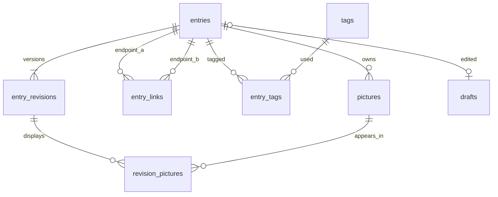

# Lore storage

Use the existing PostgreSQL server, database `hiileikehome_db`, and schema `lore`.
The application role owns this schema and needs no superuser privileges.

## Server configuration

The existing `Lore__DataDirectory=/lore-data` setting remains the attachment
directory. Reuse the existing Compose `POSTGRES_PASSWORD` variable. Set the
`hiileikehome_app` role's password to that value using `\password hiileikehome_app`
interactively in psql.

Add one entry to the existing `blazor-app.environment` list:

```yaml
- Lore__Database__Password=${POSTGRES_PASSWORD:?Set POSTGRES_PASSWORD}
```

The defaults are host `postgresql`, port `5432`, database `hiileikehome_db`, and
username `hiileikehome_app`. Optional overrides are `Lore__Database__Host`,
`Lore__Database__Port`, `Lore__Database__Name`, and `Lore__Database__Username`.
Alternatively, supply the full connection string as `ConnectionStrings__Lore`.
Password values are passed through a connection string builder, so punctuation
in a password does not become connection string syntax.

The first database operation applies the embedded, versioned SQL migration.
It creates only objects inside `lore`. A configured database failure is surfaced
to the editor. File storage is used when no database setting is supplied, for
local development. Existing test JSON is not imported automatically.

## Tables and relationships



- `entries` holds the current searchable fields and revision number.
  Kinds are Item 0, Character 1, Quest 2, and Location 3. Statuses are Idea 0,
  Planned 1, In progress 2, and Implemented 3.
- `entry_links` stores each reciprocal connection once, with the smaller UUID first.
- `tags` has a case-insensitive unique name. `entry_tags` preserves display order.
- `entry_revisions.snapshot` holds the complete historical entry as JSONB,
  including historical tags, picture names, and the names of linked entries.
  Those historical names remain available after a linked entry is renamed or deleted.
- `pictures` stores file metadata. Its `storage_key` is relative to the
  `pictures` subfolder of `Lore__DataDirectory`.
- `revision_pictures` records which pictures appeared in each revision, in order.
  Removing a picture from the current entry retains it for historical revisions.
- `drafts` has one slot per existing entry and one shared slot for a new entry.
  The new-entry slot has a null `entry_id`. Draft stamps prevent one editor from
  silently overwriting another editor's draft.
- `schema_migrations` records the installed schema version.

Deleting an entry cascades through its revisions, links, tag assignments, picture
metadata, and draft. The application then removes its picture files. Tag names
remain available in the database.

Catalog operations use a PostgreSQL transaction and a Lore-specific advisory lock.
That keeps both endpoints of a link, their histories, and their picture references
consistent across application processes. The backup script uses the same lock.

The executable table definitions are in [001_initial.sql](001_initial.sql).

## Backups

The supplied `backup.sh` backs up this schema and its pictures. It can be run
manually after database deployment, for example:

```bash
bash backup.sh /mnt/storage/backups/hiileikehome
```

It holds the Lore advisory lock while dumping `lore` and archiving the picture
folder. Lore operations wait until the backup finishes. Existing application
services and other database schemas remain online.

The included user service and timer run the installed script at 03:00
America/New_York each day, with up to five minutes of random delay. The script
and its companion `prune.py` are installed in `/home/hiileike/homelab/core/lore-backup`.
Scheduled backups go to `/mnt/storage/backups/hiileikehome/lore`. Its logs are available with
`journalctl --user -u hiileike-lore-backup.service`.
The service uses `sg docker` so the job has the account's existing Docker group
access even when the user manager was started before that membership was added.

After a successful backup, retention uses America/New_York dates and weeks
starting Monday. It keeps the latest backup for each day of the current week,
the latest backup for each earlier week of the current calendar year, and the
latest backup for each quarter of earlier years. Future-dated backups are kept.
Quarterly backups remain until a different retention policy is chosen.

Pruning requires a completed Lore backup manifest and the exact expected files.
Incomplete backups and other folders are left for manual review. Preview the
decisions with `python3 prune.py /mnt/storage/backups/hiileikehome/lore`.
Add `--apply` to perform the removals.

Each successful directory contains `lore.dump`, `pictures.tar`, and `manifest.json`. Restore the
dump into an empty database whose `lore` schema belongs to the application role.
Use `pg_restore --no-owner --no-privileges` as that role. Extract `pictures.tar`
into the attachment directory's `pictures` subfolder while Lore is offline.

The SQL dump also contains schema creation, so when restoring into an already
created `lore` schema, use a restore list that excludes its SCHEMA item.
Test restoration in a separate empty database before replacing live data.

Keep a second copy of the backup directory on independent storage. A backup on
the same DAS does not cover loss of that DAS.
